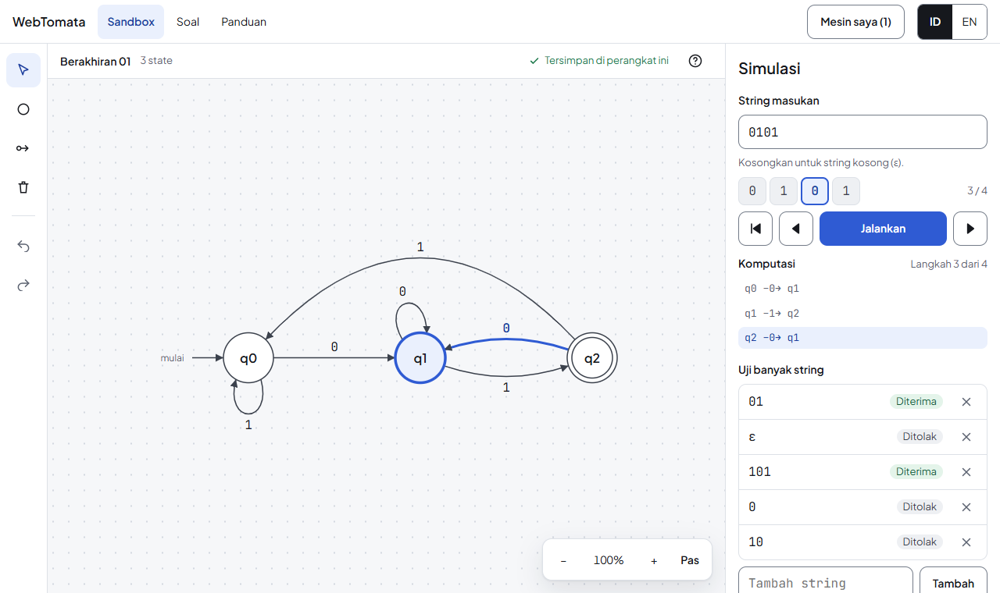

# WebTomata

**[webtomata.aldebaran26adhitya.workers.dev](https://webtomata.aldebaran26adhitya.workers.dev/)**

## ENGLISH

WebTomata is a free, open-source web tool for learning finite state machines, in **Indonesian first** (English too). It is made for students of Theory of Computation at any Indonesian computer science program. It runs in the browser, on a phone as well as a laptop, and nothing you build leaves your device.

**What you can do today**

- Build a DFSM or an NDFSM (with ε-transitions) by tapping or clicking: states, transitions, start and accepting states. Undo and redo everything.
- See what is wrong with a machine in calm words (a missing transition, an unreachable state).
- Run a string step by step. The active states light up on the diagram (all of them for an NDFSM), the edge just taken is marked, and the computation is listed.
- Test many strings at once: each one shows Diterima or Ditolak, and the results follow every change of the machine.
- Open an example in one click, or take a one-minute tour.
- Close the tab and come back: your machines are saved on your device, in a list ("Mesin saya").

**What it is not yet.** It is not a replacement for JFLAP for the whole course. These are on the way: converting an NDFSM to a DFSM, minimization, regular expressions, comparing two machines, `.jff` files and share links, practice questions with feedback, and guides on design patterns. Pushdown automata, Turing machines and grammars come later.

**Principles**

- No account, no cookies, no tracking, no server of ours. Everything runs in your browser and is saved on your device.
- The engine is written in Rust and runs in the browser as WebAssembly. A wrong answer would destroy trust, so it is tested hard.
- It teaches patterns, not homework answers. Examples and questions are original.
- Free forever, on free hosting.

**Help**

- Found a mistake, or want an example added? Read [CONTRIBUTING.md](CONTRIBUTING.md). Terms follow the [glossary](docs/glossary.md); how it is built is in [ARCHITECTURE](docs/ARCHITECTURE.md) and in the [decisions](docs/decisions/).
- Found a security problem? Please do not open a public issue: see [SECURITY.md](SECURITY.md).

## BAHASA INDONESIA

WebTomata adalah alat web gratis dan open source untuk belajar mesin berhingga (finite state machine), **berbahasa Indonesia lebih dulu** (bahasa Inggris juga ada). Alat ini dibuat untuk mahasiswa mata kuliah Teori Komputasi (Teori Bahasa dan Automata) di program studi ilmu komputer mana pun di Indonesia. Alat ini berjalan di peramban, di ponsel maupun laptop, dan apa pun yang kamu buat tidak keluar dari perangkatmu.

**Yang bisa kamu lakukan sekarang**

- Membuat DFSM atau NDFSM (dengan transisi ε) dengan mengetuk atau mengeklik: state, transisi, start state, dan accepting state. Semua bisa diurungkan dan diulangi.
- Melihat apa yang kurang dari sebuah mesin, dengan kata-kata yang tenang (transisi yang belum ada, state yang tidak bisa dicapai).
- Menjalankan satu string langkah demi langkah. State yang aktif menyala di diagram (semuanya untuk NDFSM), transisi yang baru dipakai ditandai, dan komputasinya dicatat.
- Menguji banyak string sekaligus: setiap string menunjukkan Diterima atau Ditolak, dan hasilnya ikut berubah saat mesin diubah.
- Membuka contoh dengan satu klik, atau mengikuti tur satu menit.
- Menutup tab dan kembali lagi: mesinmu tersimpan di perangkatmu, dalam daftar "Mesin saya".

**Yang belum ada.** Alat ini belum menggantikan JFLAP untuk seluruh mata kuliah. Yang sedang dikerjakan: mengubah NDFSM menjadi DFSM, minimalisasi, ekspresi reguler, membandingkan dua mesin, berkas `.jff` dan tautan berbagi, soal latihan dengan umpan balik, dan panduan pola perancangan. Pushdown automata, mesin Turing, dan tata bahasa menyusul kemudian.

**Prinsip**

- Tanpa akun, tanpa cookie, tanpa pelacakan, tanpa server milik kami. Semuanya berjalan di peramban dan tersimpan di perangkatmu.
- Engine ditulis dengan Rust dan berjalan di peramban sebagai WebAssembly. Jawaban yang salah merusak kepercayaan, jadi engine diuji dengan keras.
- Mengajarkan pola, bukan jawaban tugas. Contoh dan soal dibuat sendiri.
- Gratis selamanya, di hosting gratis.

**Bantuan**

- Menemukan kesalahan, atau ingin menambah contoh? Baca [CONTRIBUTING.md](CONTRIBUTING.md). Istilah mengikuti [glosarium](docs/glossary.md); cara pembuatannya ada di [ARCHITECTURE](docs/ARCHITECTURE.md) dan di [keputusan-keputusan](docs/decisions/).
- Menemukan masalah keamanan? Jangan membuka issue publik: lihat [SECURITY.md](SECURITY.md).

## Lisensi / License

[AGPL-3.0](LICENSE).
