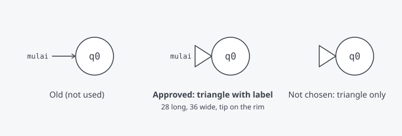

# Start state marker: a large hollow triangle (like JFLAP)

Status: approved by the owner on 2026-11-02 ("triangle with label"). Task: T-018 in `docs/agent/PLAN.md`.

## Decision

The start state of a machine is marked by a **large hollow triangle** whose tip touches the state, as JFLAP draws it, and not by a short arrow. The word **"mulai"** stays beside the triangle (the owner chose "triangle with label", not "triangle only"), because it names the idea for a beginner and the screens already show it.

Why: the students know JFLAP from the course, and the triangle is the first thing they look for. Alternatives that were drawn and not chosen: the current arrow (40 long, with an arrowhead), and the triangle without the label.

## Geometry (world units, the same units as the state radius 32)

| Part | Rule |
|---|---|
| Axis | The line from the center of the start state outward at the angle that the existing rule picks (180° when the left is free). The angle rules in `docs/ux/editor-interactions.md` do not change. |
| Tip (apex) | On the rim of the state: distance `RADIUS` = 32 from the center. |
| Base | A line perpendicular to the axis at distance 32 + 28 = 60 from the center. The triangle is **28 long** (from the tip to the base) and the base is **36 wide**, 18 on each side of the axis. |
| Shape | An isosceles triangle: three vertices, a closed path, with round joins. |
| Fill | `--color-surface` (the same as the state). |
| Stroke | 1.5, `--color-neutral-ink` (the same as the state circle). |
| Arrowhead | None. The triangle is the whole marker. |
| Label | The text "mulai" (key `diagram.start`, `--font-mono` as today) beyond the base, on the axis, placed by the same label rule as now (nearest side 4 from the shape). It must not touch the triangle or the state at any of the angles. |
| Selected, focus | The marker is not interactive, as the arrow is not today. The state keeps its selection ring and its focus ring. |
| Accepting start state | The inner circle of an accepting state does not change. The triangle touches the outer circle. |

The tip touches the rim: with a stroke of 1.5, the two strokes overlap by half a stroke width. That is intended, as in JFLAP.

## What changes and what does not

- Changes: the drawing of the start marker in the editor (Sandbox, Soal), in the read-only embeds of the guides, in the comparison player, and in the **SVG and PNG export** (they all use the same geometry function).
- Does not change: the angle rules, the label text, the state circle, the edges, the tokens, the colors (no new color, so no new contrast pair), the accessible name of the start state (it already says that it is the start state), and the `.jff` and JSON files (they do not store the marker).

## Sizes

The numbers come from the owner's JFLAP picture: the triangle is about half the diameter of the state in height and a little less in length. They are starting values. A change of a number needs the owner's approval, but the rules must hold: the triangle never covers its label or another state in the tests, and the editor still shows the whole marker inside the canvas at the first view.
