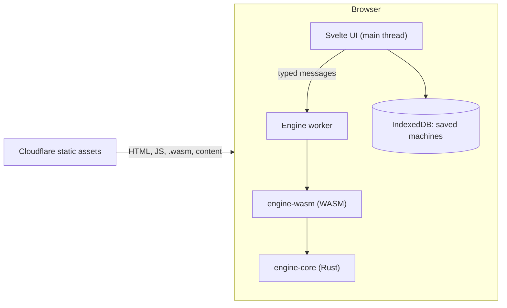

# Architecture

WebTomata is a static site. Everything runs in the visitor's browser; there is no server, database or account.

## Layers

| Layer | Where | Rule |
| --- | --- | --- |
| `engine-core` | `crates/engine-core` | Pure Rust, no browser or OS code, no `unsafe`. Returns data and message keys, never sentences. Its `api` module is the API for the web app: text in, one JSON envelope out. |
| `engine-wasm` | `crates/engine-wasm` | Thin `wasm-bindgen` layer: one line for each function of `engine_core::api`. |
| Engine client | `web/src/lib/engine` | Only `worker.ts` imports the WASM package (ESLint enforces it). The UI talks to the worker through `client.ts`, which is typed with `types.ts` (generated from the Rust types). |
| UI | `web/src` | SvelteKit, prerendered by `adapter-static`. |
| Content | `content/` | Questions and guides as plain files, compiled at build time. |
| Design tokens | `web/src/lib/styles` | `tokens.css` is the one place for colors and sizes; components use only its names (`pnpm check:tokens`). Every color pair is checked for WCAG AA contrast (`pnpm check:contrast`). See `docs/ux/design-system.md`. |

## Engine API

One WASM call for each user action. Every function takes text and returns one text, in the same envelope: `{ "ok": true, "value": … }` or `{ "ok": false, "error": <message> }`. Bad input never throws. Details are in ADR 0014 and in the doc comment of `crates/engine-core/src/api.rs`.

| Group | Functions (JavaScript names) |
| --- | --- |
| Machines | `loadMachine`, `validate`, `nondeterministicStates`, `addTrapState` |
| Run | `simulate(machine, input, budget?)` |
| Conversions | `determinize`, `minimize`, `equivalent(candidate, reference, budget?)` |
| Regular expressions | `regexToFsm(text, alphabet, budget?)`, `fsmToRegex`, `simplify(text, alphabet, budget?)` |
| Closure | `complement`, `union`, `intersection`, `xor` |
| JFLAP | `importJff(xml)`, `exportJff(machine, layout)` |
| Other | `version` |

- **Machines** are the machine file (`schemaVersion` 1). **Budgets** are partial JSON objects: a missing field keeps the default, and an unknown field is an error. The web client adds smaller budgets than the engine defaults (`WEB_BUDGETS` in `client.ts`) so that a cheap phone does not work for long.
- **Strings come with names.** `simulate` returns the input as symbol names, and `equivalent` returns the witness and the wrong-string lists as names in the alphabet of the candidate, so the UI never looks up a number in the wrong alphabet.
- **Limits** apply to every input: machine and `.jff` files 1 MiB, regular expressions 1,000 characters, simulation input 100,000 bytes, budget text 4,096 bytes.
- **The types** in `web/src/lib/engine/types.ts` are generated (`pnpm build:types`, run by `pnpm build:wasm`) and are not committed. The file also holds golden samples, real answers of every function written as constants that must fit their types, so `pnpm check` fails if a Rust type and the JSON drift apart.
- **A crash does not freeze the app.** Any exception in the worker (a WASM trap, an unknown call) makes the worker report a crash and close. The client then fails the waiting calls with `EngineCrashed`, and the next call starts a new worker. `engine.cancel()` ends the worker the same way (`EngineCancelled`). Saved machines live on the main thread and in IndexedDB, so they are not affected.
- **A call that takes too long is stopped.** A call that gets no answer within 10 seconds (30 before the worker has answered once, for loading the WASM file) fails with `EngineTimeout`. The worker is ended and replaced; the other waiting calls are sent again to the new worker. `engineProblem(error)` turns a failure into the message keys of a calm notice with a "Coba lagi" button. See ADR 0020.

## The document

The machine that the user edits is a **document** (`web/src/lib/editor/`): plain, frozen, versioned data with the states, their names and places, the alphabet, the transitions and a title. The diagram, the table and the formal definition all show it. It follows the rules of the engine, so `toMachine(doc)` is always accepted by `loadMachine`.

- **Commands** are plain data (`addState`, `moveState`, `addTransition`, `removeSymbol`, `batch`, and so on). `applyCommand(doc, command)` is a pure function that gives a new document or an error message; it never throws, and a refused command changes nothing.
- **History** (`createHistory`) keeps earlier versions of the document, so undo gives back exactly the earlier one. One gesture is one step: commands with the same `coalesce` key merge, and `seal()` ends the group. Undo covers document edits only (not selection, pan or zoom). The depth is 200 steps.
- **Files** (`serializeDocument`, `parseDocumentText`) are read strictly, with a size limit and no unknown fields. `documentFromJff` and `jffLayout` move names and places to and from a JFLAP file.
- See ADR 0017 for the decisions, and `docs/ux/editor-interactions.md` (U3, not written yet) for how the editor uses the commands.

## Trust boundary

- **Trusted:** our own code and build output served from the same origin.
- **Untrusted:** anything a user can import or open: `.jff` and JSON files, share-link fragments. These are validated for size and structure before use (E10, S10).
- **No user data leaves the device.** Machines are saved in IndexedDB and shared only as a URL fragment (`#...`), which browsers never send to a server.
- **CSP** (set per `docs/decisions/0002-deploy-cloudflare-workers.md`): scripts only from `'self'` plus `'wasm-unsafe-eval'` and one hash for SvelteKit's inline bootstrap script.

## Build and deploy

`pnpm build` runs `wasm-pack` (release, `wasm-opt -Oz`) and then `vite build` into `web/build/`. CI checks formatting, lint, types, tests, size budgets and Lighthouse budgets (`tools/budgets.mjs`). Merges to `main` deploy `web/build/` to Cloudflare; pull requests get a preview URL. The deploy is three jobs: `build` (no secrets; compiles and bundles, and saves the site), `deploy` (the only job with the Cloudflare key; a fresh computer that installs without running scripts and runs only `wrangler`), and `verify` (no secrets; checks the security headers and runs a smoke test, where headless Chrome loads the site and waits for the engine version, on the production and the preview URL). `tools/check-workflows.mjs` keeps the key in the deploy job and every action pinned to a full commit (ADR 0015). Security reports and the steps after a key leak are in `SECURITY.md` and `docs/runbook-leaked-key.md`. A weekly workflow audits the Rust and npm dependencies for known vulnerabilities; it is not a required check.

## Performance and benchmarks

Budgets are in `CLAUDE.md` §7 and enforced in CI. The `.wasm` file with the full API is about 163 KB gzip (budget 250 KB).

### Engine benchmarks (E13)

**How to run them.** `cargo bench -p engine-core` times `determinize`, `minimize` and `equivalent` natively with Criterion (`crates/engine-core/benches/engine.rs`). `pnpm build:wasm` and then `node tools/bench-wasm.mjs` time the same machines through the WASM module in Node, as the worker calls it: the machine as JSON text in, the answer as JSON text out. `cargo test -p engine-core --benches` runs each case once, and checks that every case finishes with the size that its family promises. Benchmarks do not run in CI, because shared runners are too noisy.

**The numbers are for this one computer.** Measured on 2026-10-24, on commit `b3c4f9f` plus the benchmark files: Intel Core i7-1255U (a hybrid CPU: 2 fast P-cores with 4 threads, and 8 slow E-cores), 16 GB, Windows 11, mains power, the Balanced power plan, Rust 1.99.1 (the benchmark uses the release settings of the workspace, `opt-level = "z"`, as the shipped engine does), Node 24.21.0.

- **Quiet machine, pinned.** Only Claude Desktop and two small tray programs were running (about 13% CPU, part of it the measurement itself). The benchmark was pinned to two P-core threads with high priority. Each table shows the lowest and the highest value of **three runs**. The runs differ by at most 8% natively and 12% in WASM.
- **Why pinned.** On this CPU, Windows moves a thread between P-cores and E-cores. A first set of runs with other programs open was up to 60% apart between two runs, and 25 to 40% slower. The numbers below are therefore close to the best this computer can do. A real browser is not pinned: it took 1.1 to 1.4 times the pinned Node time for the 500-state cases (see the browser check below).
- **A phone is slower.** WASM through the API took about 1.7 to 3.3 times the native time at 500 states (and more at 10 states, where the JSON text costs more than the engine), and a mid-range Android phone is typically several times slower than a laptop CPU. We did not measure a phone. Do not read these numbers as a promise for phones.

| What is timed (native) | 10 states | 100 states | 500 states |
| --- | --- | --- | --- |
| `determinize`: NFA "ends in n−1 a's", n states in, n out | 27 µs – 28 µs | 0.82 ms – 0.89 ms | 18 ms – 19 ms |
| `minimize`: random complete DFSM, 3 symbols | 38 µs – 40 µs | 1.5 ms | 33 ms – 34 ms |
| `minimize`: chain of n states, already minimal (about n rounds of splitting) | 28 µs | 1.3 ms | 32 ms – 33 ms |
| `equivalent`: a counter modulo n and the same machine renumbered (the whole product is explored) | 20 µs | 0.23 ms – 0.24 ms | 0.94 ms – 0.97 ms |
| `equivalent`: a counter modulo n and modulo n+2 (a witness is found, and up to 5 wrong strings of length ≤ 8 are listed on each side) | 0.25 ms – 0.26 ms | 0.52 ms – 0.53 ms | 1.3 ms |

| `determinize`: "the k-th symbol from the end is a" (k+1 states in, 2^k out) | k = 6 (64 states) | k = 8 (256 states) | k = 10 (1,024 states) |
| --- | --- | --- | --- |
| Native | 0.12 ms – 0.13 ms | 0.53 ms – 0.55 ms | 2.6 ms – 2.7 ms |
| WASM through the API, in Node | 0.49 ms – 0.54 ms | 2.1 ms | 8.5 ms – 8.7 ms |

WASM through the API, in Node, for the same cases as the first table:

| What is timed | 10 states | 100 states | 500 states |
| --- | --- | --- | --- |
| `determinize` ends_with_a | 0.13 ms – 0.14 ms | 2.0 ms – 2.1 ms | 32 ms – 33 ms |
| `minimize` random | 0.18 ms | 3.6 ms – 3.8 ms | 57 ms |
| `minimize` chain | 0.11 ms – 0.12 ms | 2.8 ms – 2.9 ms | 54 ms – 56 ms |
| `equivalent` same language | 70 µs | 0.47 ms – 0.48 ms | 2.3 ms – 2.4 ms |
| `equivalent` different | 0.26 ms – 0.29 ms | 0.84 ms – 0.88 ms | 3.1 ms |

**Browser check.** The same calls in the real browser (Chromium inside Claude Desktop, through the worker, not pinned): `determinize` ends_with_a 500 took 35 ms (pinned Node: 32 ms), `minimize` random 500 took 77 ms (pinned Node: 57 ms), and `minimize` on a chain of 2,000 states took 1.4 s (pinned Node: 0.65 s).

**What the numbers show**
- `determinize` and `minimize` grow roughly with the square of the number of states: from 100 to 500 states (5 times more), `determinize` ends_with_a takes about 21 times longer and `minimize` random about 22 times longer. `equivalent` grows 2.5 to 4 times, roughly in step with the number of state pairs, so it is cheap.
- The worst case of subset construction is limited by `MAX_STATES`: k = 10 (1,024 states) takes under 3 ms natively, so the 2,000-state limit is not a time problem.
- **A slow case, found while checking the web budgets.** `minimize` on a chain of 2,000 states (the largest machine the engine accepts) takes 0.65 to 0.69 s pinned in Node and 1.4 s in the real browser on this computer. The web budget `maxSteps: 20000` does not stop it, because the number of trace steps does not bound the running time. On a phone this could take several seconds. A student can cancel the call (`engine.cancel()`), and the machines in a course are far smaller (500 states take under 0.1 s), but a very large imported file could hit this. This is not fixed in E13. Options for a later task: a faster implementation that keeps Rich's trace, or a smaller limit on the machine size for `minimize` in the web client.
- **`fsmToRegex` and the budget `maxNodes: 500`.** Time is not the limit here: every call took under 4 ms. Machines of textbook size (up to 12 states with few transitions) finish within 500 nodes, but a dense random machine of 6 states already stops at 500, and the engine default of 2,000 nodes finishes up to about 10 states (an expression of about 1,800 characters, which no student can read). The budget is a bound on readability, not on time.
- The other web budgets from E12 hold: `determinize` on a 2,000-state input stops at 500 states after about 30 ms (without the budget it takes 0.44 s), and `equivalent` needs about 10 ms for 2,000 pairs, so 20,000 pairs is about 0.1 s.
