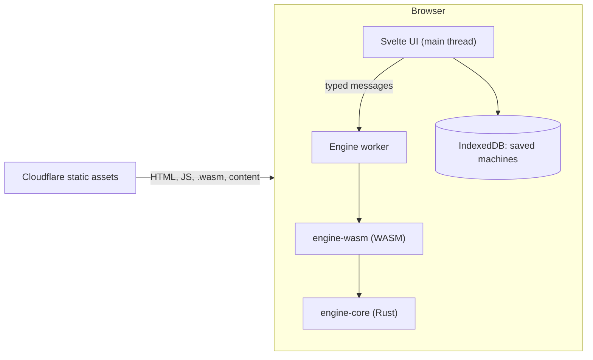

# Architecture

WebTomata is a static site. Everything runs in the visitor's browser; there is no server, database or account.

## Layers

| Layer | Where | Rule |
| --- | --- | --- |
| `engine-core` | `crates/engine-core` | Pure Rust, no browser or OS code, no `unsafe`. Returns data and message keys, never sentences. Its `api` module is the API for the web app: text in, one JSON envelope out. |
| `engine-wasm` | `crates/engine-wasm` | Thin `wasm-bindgen` layer: one line for each function of `engine_core::api`. |
| Engine client | `web/src/lib/engine` | Only `worker.ts` imports the WASM package (ESLint enforces it). The UI talks to the worker through `client.ts`, which is typed with `types.ts` (generated from the Rust types). |
| UI | `web/src` | SvelteKit, prerendered by `adapter-static`. |
| Content | `content/` | Questions and guides as plain files, compiled at build time. |

## Engine API

One WASM call for each user action. Every function takes text and returns one text, in the same envelope: `{ "ok": true, "value": … }` or `{ "ok": false, "error": <message> }`. Bad input never throws. Details are in ADR 0014 and in the doc comment of `crates/engine-core/src/api.rs`.

| Group | Functions (JavaScript names) |
| --- | --- |
| Machines | `loadMachine`, `validate`, `nondeterministicStates`, `addTrapState` |
| Run | `simulate(machine, input, budget?)` |
| Conversions | `determinize`, `minimize`, `equivalent(candidate, reference, budget?)` |
| Regular expressions | `regexToFsm(text, alphabet, budget?)`, `fsmToRegex`, `simplify(text, alphabet, budget?)` |
| Closure | `complement`, `union`, `intersection` |
| JFLAP | `importJff(xml)`, `exportJff(machine, layout)` |
| Other | `version` |

- **Machines** are the machine file (`schemaVersion` 1). **Budgets** are partial JSON objects: a missing field keeps the default, and an unknown field is an error. The web client adds smaller budgets than the engine defaults (`WEB_BUDGETS` in `client.ts`) so that a cheap phone does not work for long.
- **Strings come with names.** `simulate` returns the input as symbol names, and `equivalent` returns the witness and the wrong-string lists as names in the alphabet of the candidate, so the UI never looks up a number in the wrong alphabet.
- **Limits** apply to every input: machine and `.jff` files 1 MiB, regular expressions 1,000 characters, simulation input 100,000 bytes, budget text 4,096 bytes.
- **The types** in `web/src/lib/engine/types.ts` are generated (`pnpm build:types`, run by `pnpm build:wasm`) and are not committed. The file also holds golden samples, real answers of every function written as constants that must fit their types, so `pnpm check` fails if a Rust type and the JSON drift apart.
- **A crash does not freeze the app.** Any exception in the worker (a WASM trap, an unknown call) makes the worker report a crash and close. The client then fails the waiting calls with `EngineCrashed`, and the next call starts a new worker. `engine.cancel()` ends the worker the same way (`EngineCancelled`). Saved machines live on the main thread and in IndexedDB, so they are not affected.

## Trust boundary

- **Trusted:** our own code and build output served from the same origin.
- **Untrusted:** anything a user can import or open: `.jff` and JSON files, share-link fragments. These are validated for size and structure before use (E10, S10).
- **No user data leaves the device.** Machines are saved in IndexedDB and shared only as a URL fragment (`#...`), which browsers never send to a server.
- **CSP** (set per `docs/decisions/0002-deploy-cloudflare-workers.md`): scripts only from `'self'` plus `'wasm-unsafe-eval'` and one hash for SvelteKit's inline bootstrap script.

## Build and deploy

`pnpm build` runs `wasm-pack` (release, `wasm-opt -Oz`) and then `vite build` into `web/build/`. CI checks formatting, lint, types, tests, size budgets and Lighthouse budgets (`tools/budgets.mjs`). Merges to `main` deploy `web/build/` to Cloudflare; pull requests get a preview URL.

## Performance and benchmarks

Budgets are in `CLAUDE.md` §7 and enforced in CI. Engine benchmarks (E13) will be recorded here. The `.wasm` file with the full API is about 163 KB gzip (budget 250 KB).
