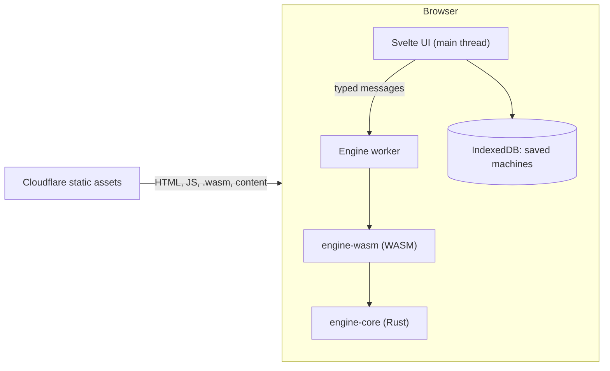

# Architecture

WebTomata is a static site. Everything runs in the visitor's browser; there is no server, database or account.

## Layers

| Layer | Where | Rule |
| --- | --- | --- |
| `engine-core` | `crates/engine-core` | Pure Rust, no browser or OS code, no `unsafe`. Returns data and message keys, never sentences. |
| `engine-wasm` | `crates/engine-wasm` | Thin `wasm-bindgen` layer. One call per user action. |
| Engine client | `web/src/lib/engine` | Only `worker.ts` imports the WASM package (ESLint enforces it). The UI talks to the worker through `client.ts`. |
| UI | `web/src` | SvelteKit, prerendered by `adapter-static`. |
| Content | `content/` | Questions and guides as plain files, compiled at build time. |

## Trust boundary

- **Trusted:** our own code and build output served from the same origin.
- **Untrusted:** anything a user can import or open: `.jff` and JSON files, share-link fragments. These are validated for size and structure before use (E10, S10).
- **No user data leaves the device.** Machines are saved in IndexedDB and shared only as a URL fragment (`#...`), which browsers never send to a server.
- **CSP** (set per `docs/decisions/0002-deploy-cloudflare-workers.md`): scripts only from `'self'` plus `'wasm-unsafe-eval'` and one hash for SvelteKit's inline bootstrap script.

## Build and deploy

`pnpm build` runs `wasm-pack` (release, `wasm-opt -Oz`) and then `vite build` into `web/build/`. CI checks formatting, lint, types, tests, size budgets and Lighthouse budgets (`tools/budgets.mjs`). Merges to `main` deploy `web/build/` to Cloudflare; pull requests get a preview URL.

## Performance and benchmarks

Budgets are in `CLAUDE.md` §7 and enforced in CI. Engine benchmarks (E13) will be recorded here.
