# Wireframes

The approved wireframes for v1 (task U1), as screenshots, with the decisions behind them. The owner approved them on 2026-10-24. Build screens to match them. If a screen is missing or unclear, ask; do not invent a layout (`CLAUDE.md` section 6).

How to read them:

- They are static pictures with sample data. The machines, counts and times are examples. `[Judul soal 2]` and `[Judul soal 3]` are placeholders for questions that do not exist yet.
- Words follow [`glossary.md`](../glossary.md) ("state", not "status"). Colors, type and sizes follow [`design-system.md`](design-system.md). What each editor action does is in [`editor-interactions.md`](editor-interactions.md).
- The sources (one HTML file per screen) are private, in `MD_FILES/wireframes-src/`. The screenshots were rendered from them with headless Chrome.

## Screens

| Screen                      | Laptop (1440 px)                                                 | Phone (390 px)                                                | Built by   |
| --------------------------- | ---------------------------------------------------------------- | ------------------------------------------------------------- | ---------- |
| Sandbox                     | [sandbox-laptop](wireframes/sandbox-laptop.png)                  | [sandbox-phone](wireframes/sandbox-phone.png)                 | S1, S4, S6 |
| First run (empty Sandbox)   | [first-run-laptop](wireframes/first-run-laptop.png)              | [first-run-phone](wireframes/first-run-phone.png)             | X1         |
| Mesin saya (saved machines) | [my-machines-laptop](wireframes/my-machines-laptop.png) (dialog) | [my-machines-phone](wireframes/my-machines-phone.png) (sheet) | S10a, S10b |
| Soal                        | [soal-laptop](wireframes/soal-laptop.png)                        | [soal-phone](wireframes/soal-phone.png)                       | Q3, Q4     |
| Panduan, list               | [guides-laptop](wireframes/guides-laptop.png)                    | [guides-phone](wireframes/guides-phone.png)                   | G1         |
| Panduan, one guide          | [guide-laptop](wireframes/guide-laptop.png)                      | [guide-phone](wireframes/guide-phone.png)                     | G1, G2     |

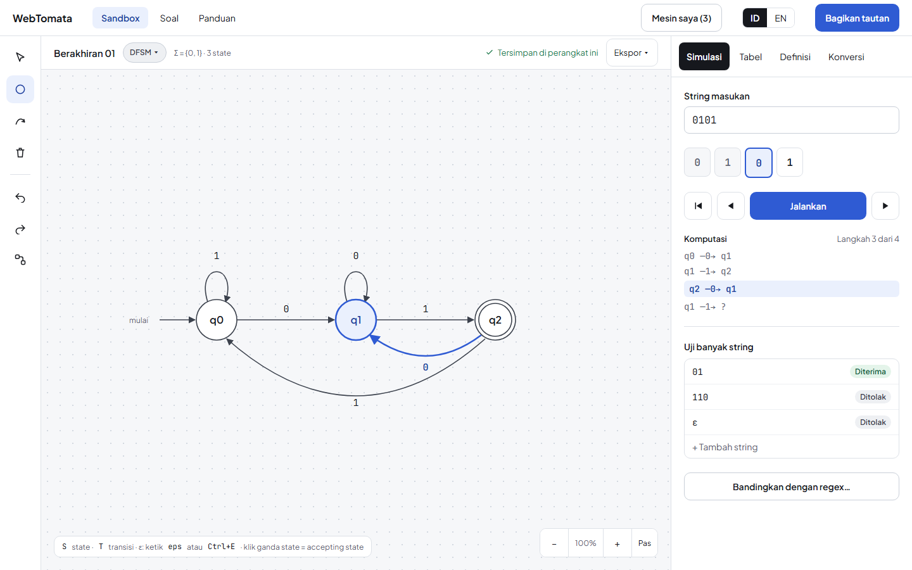

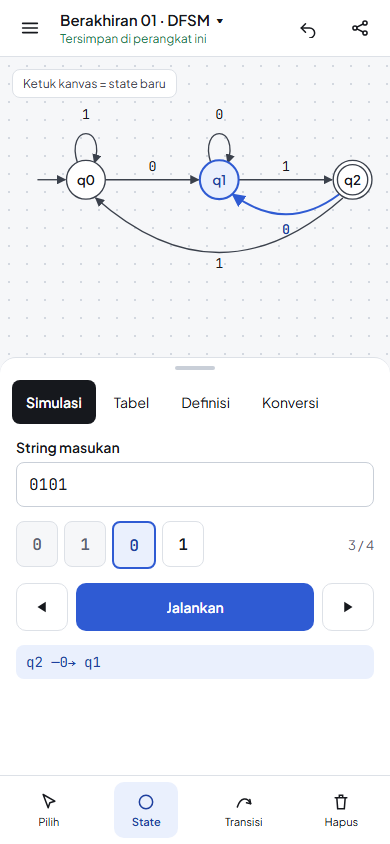

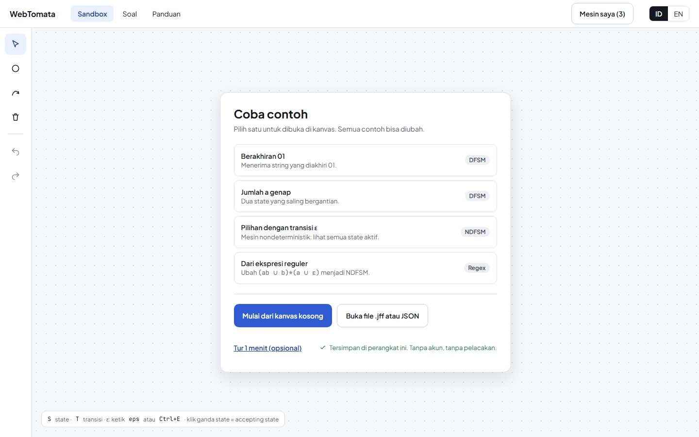

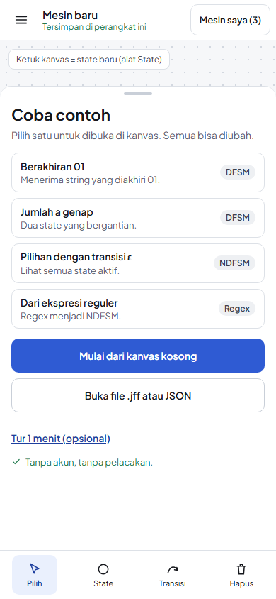

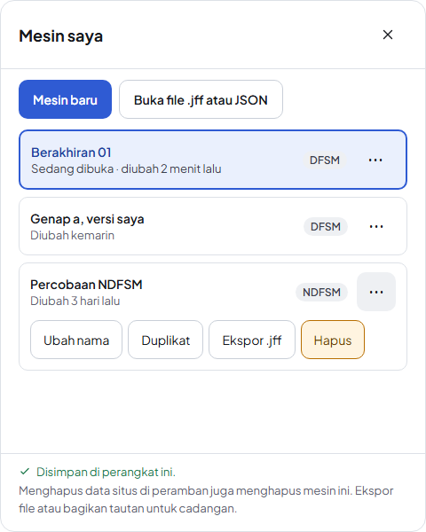

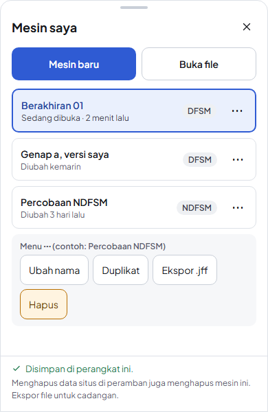

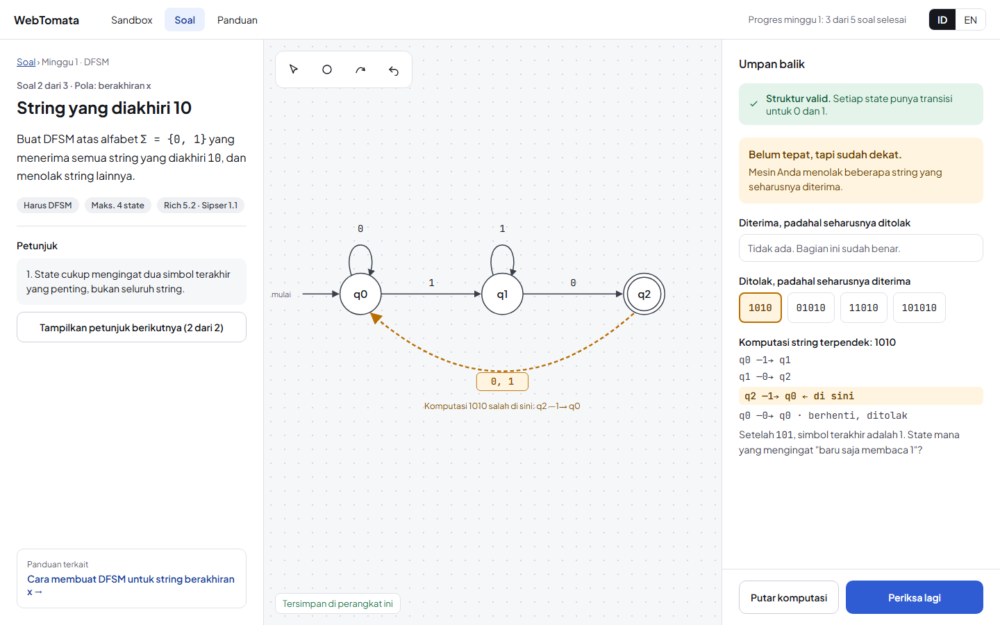

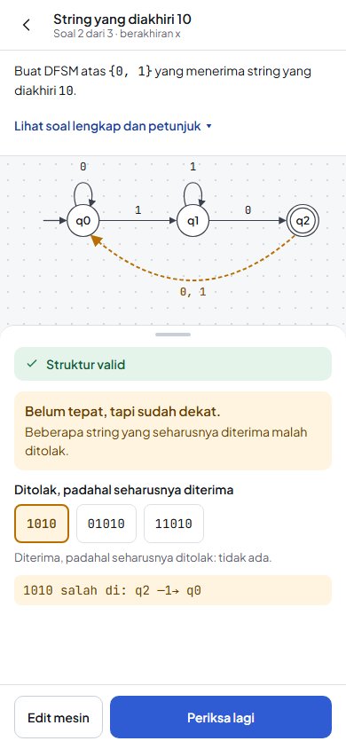

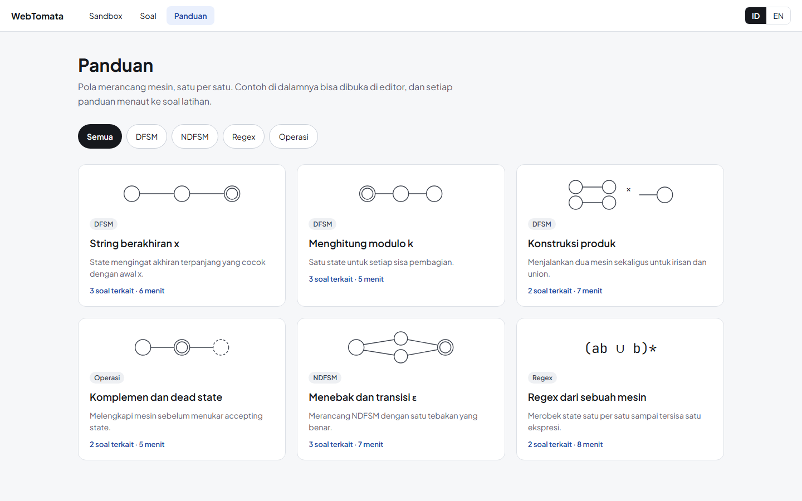

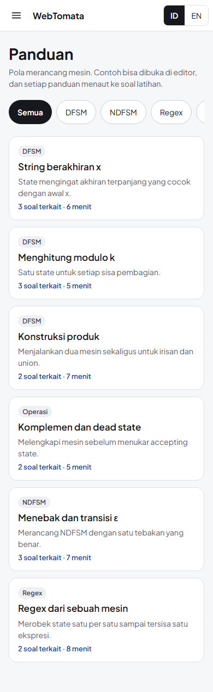

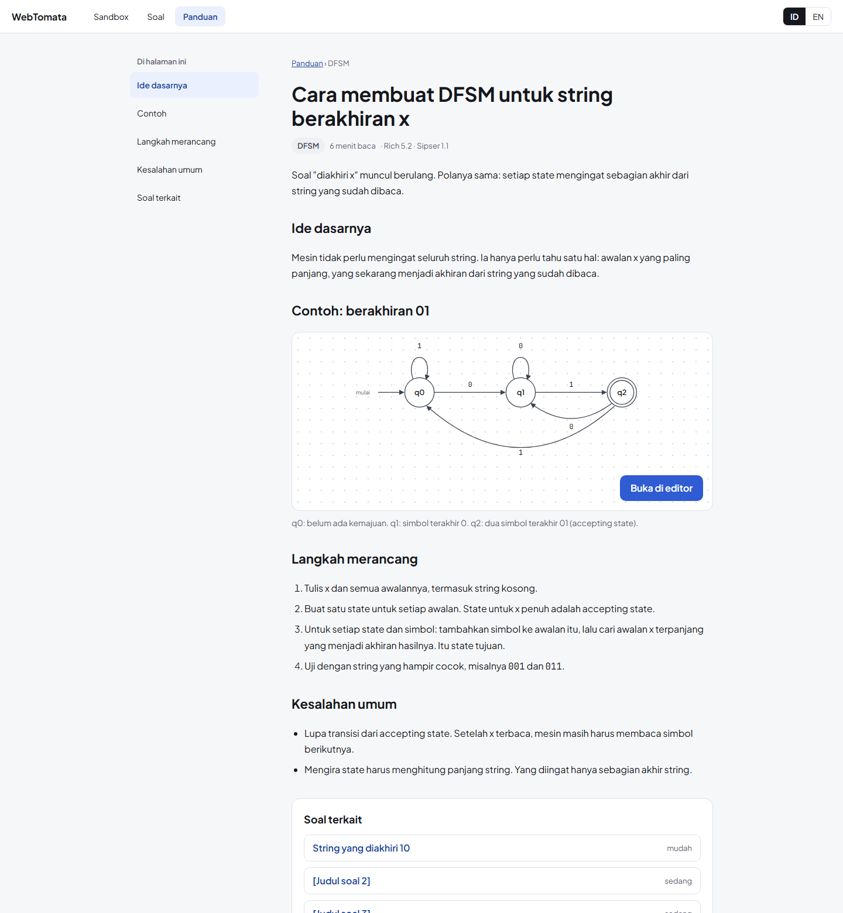

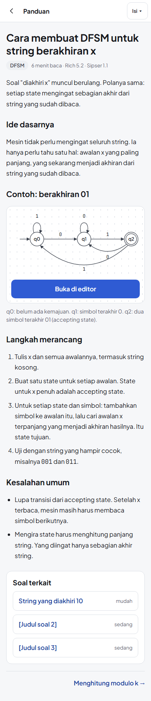

## Decisions

1. **Words.** "State" everywhere: tool names, menus, messages. A step-by-step run is a "komputasi", a step of a conversion is a "langkah" (not "jejak"). See the glossary.
2. **Name.** The product is shown as "WebTomata" in the header.
3. **No notation switch in v1.** The header has no "Notasi" select. Rich notation only; labels live in message files so a switch can come later.
4. **Machine type.** The "DFSM ▾" chip is a control, not a label. The user picks DFSM or NDFSM (default DFSM). A wrong choice shows calm validation messages and never blocks editing.
5. **ε on the phone.** There is no permanent ε button in the dock (it has four tools: Pilih, State, Transisi, Hapus). The "Ketik ε" button lives in the label field's own bar and shows only while a label field is open. On the laptop, ε is typed as `eps`, the character `ε`, or Ctrl+E. `E` alone is not a shortcut.
6. **Tapping the canvas.** "Ketuk kanvas = state baru" holds in the State tool. In Pilih, a tap on empty canvas clears the selection.
7. **Saved machines.** "Mesin saya (n)" in the header opens a list: open, rename, duplicate, export `.jff`, delete, new, import. The footer says plainly that clearing site data deletes the machines, and that export is the backup.
8. **Compare.** The button says "Bandingkan dengan mesin ini" and is in the regex form of the Konversi tab (S8; see editor-interactions.md). Comparing with another saved machine is not in v1.
9. **First run.** An empty Sandbox shows "Coba contoh" (four examples, one click each), "Mulai dari kanvas kosong", "Buka file .jff atau JSON", an optional "Tur 1 menit", and the line "Tanpa akun, tanpa pelacakan". The "Mesin saya" button shows a count when machines are saved.
10. **Feedback panel.** Structure check, verdict, the two wrong-string lists, then the computation of the shortest wrong string. No numbers on the sections: the order is the structure. The wording follows U4.
11. **Panduan.** The list has topic filters (Semua, DFSM, NDFSM, Regex, Operasi) and cards by pattern, each with its number of linked questions and reading time. A guide has a reading column of about 68 characters, a contents list (a "Isi" button on the phone), one read-only machine with "Buka di editor", steps, common mistakes, linked questions and a next link. Guide pages need almost no JavaScript apart from the embed.
12. **Targets.** Every tap target is at least 44 × 44 px (`--target-min`), including the zoom control, the tabs and the wrong-string chips.
13. **Zoom.** The laptop zoom control has "−", the percentage, "+" and "Pas" (fit). The phone zooms by pinching and has no zoom control.

## Open questions

These do not block M1. Each has an owner task.

1. **Selecting several items on touch** is not in v1 (U5 decides after the first usability round).
2. **The one-minute tour.** The first-run screen links to it, but its steps are not designed. X1 writes them, shortest possible, and the owner approves them.
3. **The example machines** in "Coba contoh": X1 ships three (Berakhiran 01, Jumlah a genap, a union through ε); the regex example of the wireframe joins with S7, and "Buka file .jff atau JSON" with S10b. They must be patterns, never course homework.
4. **Section numbers** "Rich 5.2 · Sipser 1.1" come from the first wireframes and are not verified. Check them in G3 and Q6 before they ship.
5. **Question titles** in the guide ("Soal terkait") are placeholders until Q6.
6. **Screens not drawn yet:** the Soal list page (Q3), (the Tabel and Definisi tabs were drawn and approved on 2026-10-26; see editor-interactions.md), (the Konversi tab and the conversion step view were drawn and approved on 2026-10-26; see editor-interactions.md), the "compare with regex" view (S8), and error and stopped states of the engine (S2). Each needs a wireframe before its task starts, and the owner approves it.
7. **The word "Sandbox"** has no course source. It stays unless the owner or the lecturer asks for an Indonesian word.
8. **Sorting and size of the guide list.** Six cards fit; a longer list may need a search box. Decide in G3.
